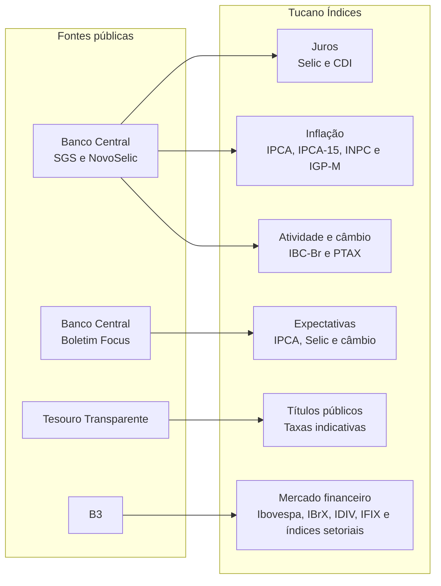

# Tucano Índices - Mercado Financeiro

[](https://go.dev/)
[](https://www.postgresql.org/)
[](https://docs.docker.com/compose/)
[](https://helm.sh/)
[](https://vitepress.dev/)
[](LICENSE)

Backend dedicado a reunir e disponibilizar índices financeiros e indicadores econômicos do Brasil. A API oferece valores mais recentes e séries históricas prontas para aplicações, análises e gráficos.

## O que você encontra aqui

- **Índices em um só catálogo:** indicadores de juros, inflação, atividade econômica, câmbio e mercado financeiro.
- **Valores atuais e histórico:** consultas simples para obter o valor final ou uma série temporal.
- **Dados atualizados automaticamente:** sincronizações programadas e execução manual dos workers.
- **Histórico de revisões:** correções recebidas das fontes são registradas sem apagar os valores anteriores.
- **Integração direta:** API HTTP protegida por token, sem contas de usuário ou níveis de acesso.

O projeto é um backend; não inclui interface de usuário ou dashboard.

## Indicadores e fontes

O diagrama resume os principais grupos do catálogo e as fontes públicas usadas para sincronizá-los:



A frequência e o histórico disponíveis dependem da série e da fonte de origem.

## Documentação

A [documentação online](https://joselarantes.github.io/tucano-indices/) explica a API, as fontes de dados e a operação dos workers. A especificação também está disponível em [OpenAPI](api/openapi.yaml).

## Informações técnicas

### Executar localmente

Requisitos: Docker e Docker Compose.

Os alvos `make` do projeto executam suas ferramentas dentro de containers Docker Compose; não é necessário instalar Go, Node.js ou golangci-lint no host.

Crie `.env` a partir de `.env.example` usando seu editor de texto e defina um valor próprio para `API_TOKEN`. Em seguida, inicie a API e os serviços necessários:

```sh
make up
```

A API ficará disponível em `http://localhost:8011`.

- Verificação de saúde: [http://localhost:8011/healthz](http://localhost:8011/healthz)
- Swagger UI: [http://localhost:8011/swagger](http://localhost:8011/swagger)
- Especificação OpenAPI: [http://localhost:8011/openapi.yaml](http://localhost:8011/openapi.yaml)

As rotas de dados e operações exigem o cabeçalho `Authorization: Bearer <API_TOKEN>`. Por exemplo:

```sh
docker compose exec api curl -H 'Authorization: Bearer <API_TOKEN>' \
  http://localhost:8080/v1/indices
```

### Endpoints principais

| Método | Endpoint | Uso |
|---|---|---|
| `GET` | `/v1/indices` | Lista as séries do catálogo. |
| `GET` | `/v1/indices/{code}/final` | Consulta o valor mais recente de uma série. |
| `GET` | `/v1/indices/{code}/series` | Obtém dados históricos para gráficos. |
| `POST` | `/v1/operations/sync/{source}` | Solicita a sincronização de uma fonte. |
| `GET` | `/v1/operations/sync-runs` | Consulta o histórico de sincronizações. |

A especificação OpenAPI contém os parâmetros, formatos, filtros e respostas completos.

### Sincronização e operação

O scheduler executa os workers em dias úteis no fuso `America/Sao_Paulo`. Também é possível solicitar uma sincronização manual:

```sh
make sync-indices SOURCE=all
make sync-indices SOURCE=b3 ARGS="-from 2024-01-01 -to 2024-12-31"
```

Para executar o scheduler localmente:

```sh
make indices-scheduler
```

Os runbooks de sincronização e de cada worker estão na [documentação](https://joselarantes.github.io/tucano-indices/).

### Arquitetura

O serviço é implementado em Go, usa PostgreSQL para armazenar séries, revisões e execuções de sincronização, e inclui migrations para preparar o banco. Docker Compose oferece um ambiente local; o chart Helm em [deploy/tucano-indices](deploy/tucano-indices) permite instalação em Kubernetes. A documentação é gerada com VitePress e publicada no GitHub Pages.

Os pontos são identificados por série, dimensão e data de referência. Repetições idênticas são idempotentes; correções criam uma nova revisão, preservando o histórico anterior. Os workers mantêm um registro das execuções e usam locks no banco para evitar sincronizações concorrentes da mesma fonte.

### Desenvolvimento

Testes:

```sh
make test
```

Documentação:

```sh
make docs
```

Site de documentação ficará em `http://localhost:5181`.

## Licença

Este projeto está sob a licença [MIT](LICENSE), de JoseLArantes.
