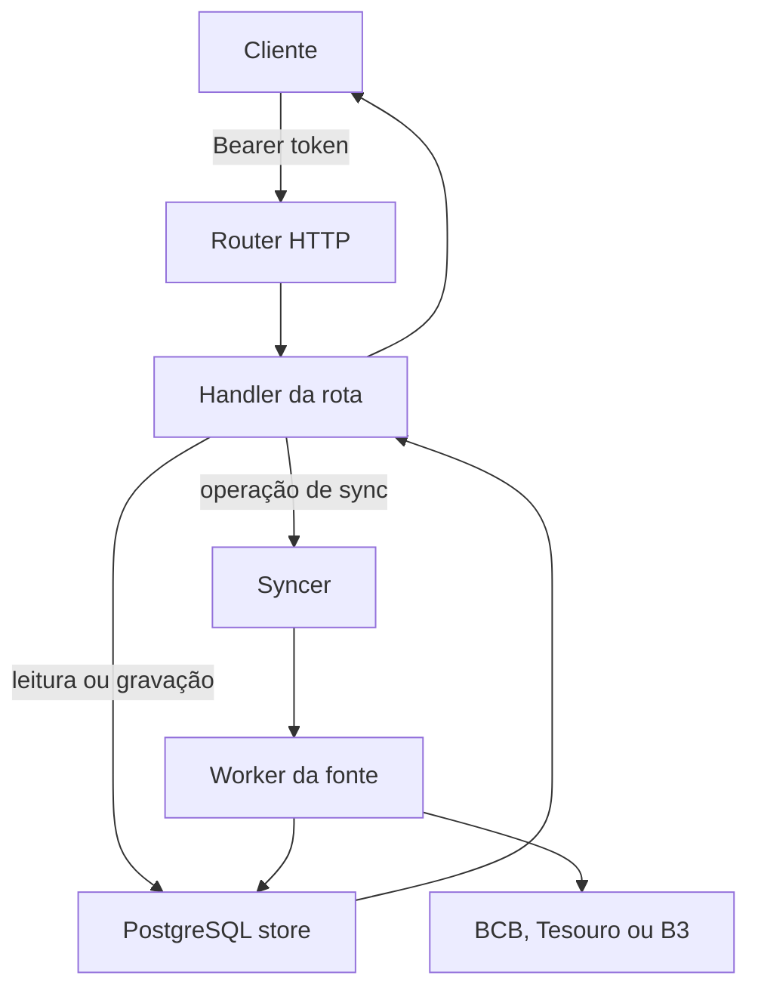

# API Tucano Indices

## Objetivo

A API expõe o catálogo brasileiro de índices e séries econômicas, seus valores finais, séries históricas para gráficos, importação manual, histórico da Selic e operações dos workers. O contrato completo fica em `api/openapi.yaml` no repositório. Com o serviço ativo, a interface interativa está em `/swagger` e o YAML publicado pela aplicação em `/openapi.yaml`. A página usa Swagger UI 5.34.1 via unpkg; o navegador precisa acessar `unpkg.com` para carregar CSS e JavaScript. O contrato OpenAPI continua sendo servido localmente pela API.

O backend não possui usuários ou papéis. Todas as rotas versionadas exigem o token estático configurado em `API_TOKEN`; `BEARER_TOKEN` é aceito como fallback de configuração. Envie o token em `Authorization: Bearer <token>` ou `X-API-Key: <token>`. As rotas públicas são `/healthz`, `/openapi.yaml` e `/swagger`.

## Endpoints

| Método | Endpoint | Acesso | Finalidade |
|---|---|---|---|
| `GET` | `/healthz` | Público | Health check da API e do banco. |
| `GET` | `/openapi.yaml` | Público | Baixa o contrato OpenAPI 3.1. |
| `GET` | `/swagger` | Público | Abre o Swagger UI para explorar e chamar as rotas. |
| `GET` | `/v1/indices` | Token | Lista o catálogo; filtra por grupo/códigos e pode incluir os valores finais. |
| `GET` | `/v1/indices/{code}/final` | Token | Retorna o último valor publicado por dimensão, opcionalmente limitado por `as_of`. |
| `GET` | `/v1/indices/{code}/series` | Token | Retorna pontos ordenados para montar gráficos. |
| `PUT` | `/v1/indices/{code}/observations` | Token | Importa observações ou registra correções com idempotência. |
| `GET` | `/v1/selic` | Token | Lista Selic apurada, paginada e ordenada do mais recente para o mais antigo. |
| `GET` | `/v1/selic/latest` | Token | Consulta o último ponto detalhado da Selic apurada. |
| `GET` | `/v1/selic/{date}` | Token | Consulta Selic apurada em uma data ISO. |
| `POST` | `/v1/selic/import` | Token | Importa CSV oficial em texto ou multipart. |
| `POST` | `/v1/indices/sync/{source}` | Token | Dispara uma sincronização (`all`, `sgs`, `focus`, `tesouro`, `b3`, `selic`). |
| `POST` | `/v1/operations/sync/{source}` | Token | Alias para disparo manual de sincronização. |
| `GET` | `/v1/operations/sync-runs` | Token | Lê as execuções recentes do ledger, com filtro opcional por fonte. |
| `GET` | `/v1/system/workers` | Token | Lista os cinco workers e as últimas 20 execuções. |
| `GET` | `/v1/system/workers/runs` | Token | Alias do ledger de sincronização. |
| `POST` | `/v1/system/workers/{source}/run` | Token | Alias para disparo manual de worker. |

## Consultas de índice

### Catálogo

`GET /v1/indices?group=4&codes=ibov,idiv&latest=true`

`group=0` lista todos os grupos; os valores válidos são de `0` a `6`. `codes` é uma lista separada por vírgulas. Quando `latest=true`, cada série recebe a propriedade `latest`, contendo um ponto por dimensão. Sem esse parâmetro, a resposta contém somente metadados.

### Valor final

`GET /v1/indices/focus_ipca/final?dim=2028&as_of=2026-11-18`

`dim` filtra a dimensão (por exemplo, ano-alvo do Focus ou ano de vencimento do Tesouro). Sem `dim`, retorna o último ponto de cada dimensão; `dim=*` também significa todas. `as_of` exclui dados com data de referência posterior ao dia informado.

A resposta contém `series`, `data` e `warnings`. Os avisos possíveis são `no_observations` e `latest_observation_may_be_stale`. Se a série ou seu valor não existir, a API responde `404`.

### Série para gráficos

`GET /v1/indices/ibov/series?from=2026-01-01&to=2026-11-18&last=250&resolution=weekly`

Os pontos têm formato compacto `{ "x": "YYYY-MM-DD", "y": "decimal" }`, além de dimensão, origem e atributos opcionais. Os valores numéricos são strings para preservar precisão. `resolution=weekly` ou `monthly` escolhe o último ponto de cada período. A resposta é ordenada por data crescente. `last` limita aos pontos mais recentes e prevalece sobre `limit`; o máximo é 20.000. `start` e `end` são aliases antigos de `from` e `to`.

## Escritas idempotentes

`PUT /v1/indices/{code}/observations` recebe:

```json
{
  "items": [
    {
      "date": "2026-11-18",
      "value": "158123.45",
      "dimension": "",
      "source": "operator-correction",
      "attributes": { "note": "fechamento oficial" }
    }
  ]
}
```

A chamada exige o cabeçalho `Idempotency-Key` (máximo de 200 caracteres). A primeira aplicação responde `201`; uma repetição com a mesma chave e mesmo corpo responde `200` e `Idempotent-Replay: true`. A mesma chave com operação ou conteúdo diferente responde `409`. Correção de valor cria uma revisão; valores equivalentes não criam revisão.

`POST /v1/selic/import` aceita o CSV diretamente no corpo (`text/csv` ou `application/octet-stream`) ou um multipart com campo `file`. O CSV usa `;` como separador e requer `Data` e `Taxa (% a.a.)`. Limite de leitura: 20 MiB. A resposta inclui linhas lidas, gravadas, intervalo de datas e a origem.

## Rotas de Selic

`GET /v1/selic?from=2026-01-01&to=2026-11-18&limit=100&offset=0` pagina observações. `limit` aceita de 1 a 1.000; padrão 100. A resposta contém `items`, `total`, `limit` e `offset`. Cada item expõe taxa anual, origem, data/hora de atualização e campos estatísticos disponibilizados pelo BCB, como fator diário, volume financeiro, operações, média, mediana, moda, desvio padrão e curtose.

## Operações e erros

`POST /v1/indices/sync/{source}?from=2026-01-01&to=2026-11-18` executa uma carga pontual. `/v1/operations/sync/{source}` e `/v1/system/workers/{source}/run` também aceitam a chamada como aliases; datas são opcionais. Uma fonte com lock em uso retorna `200` e `status=skipped`. Falhas de consulta ou persistência retornam `502` com o resumo do worker. `GET /v1/operations/sync-runs?source=b3&limit=20` lista execuções, estados, intervalos, contagem de pontos e mensagens de erro.

Os erros usam o envelope `{ "error": { "code": "...", "message": "..." } }`. Os códigos HTTP mais comuns são `400` (entrada inválida), `401` (token), `404` (série/valor), `409` (idempotência), `500` (falha interna) e `502` (falha de fonte externa).

## Fluxo


