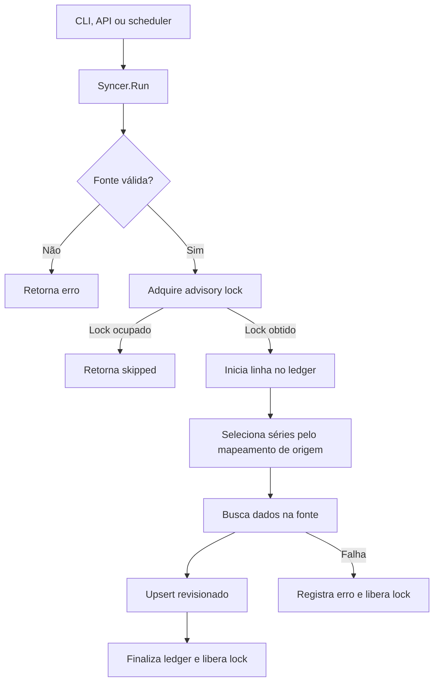

# Serviço de sincronização de índices

## Responsabilidade

O `Syncer` seleciona séries do catálogo pela origem, obtém um lock exclusivo por fonte, define a janela de datas, consulta o adaptador correspondente, grava observações versionadas e registra a execução em `index_sync_runs`. A mesma implementação atende o CLI, o scheduler e as rotas de operação da API.

Fontes aceitas: `sgs`, `focus`, `tesouro`, `b3`, `selic` e `all`. `all` executa as cinco fontes em sequência, agrega séries e pontos, tenta concluir as demais fontes mesmo após uma falha e retorna status `failed` com os erros parciais.

## Execução pelo CLI

O binário é `/app/index-sync` e recebe:

| Opção | Uso |
|---|---|
| `-source` | Fonte; padrão `INDICES_SYNC_SOURCE` ou `all`. |
| `-from YYYY-MM-DD` | Início explícito da carga. |
| `-to YYYY-MM-DD` | Fim explícito da carga; sem valor usa a data local de São Paulo. |

Exemplos:

```sh
make sync-indices SOURCE=sgs
make sync-indices SOURCE=all ARGS="-from 2024-01-01 -to 2026-11-18"
make sync-indices SOURCE=b3 ARGS="-from 1998-01-01 -to 2026-11-18"
```

O comando precisa de `DATABASE_URL`, acesso HTTP à fonte escolhida e migrações aplicadas. Não precisa de token HTTP porque executa fora da API.

## Endpoints de operação

| Método | Endpoint | Detalhe |
|---|---|---|
| `POST` | `/v1/operations/sync/{source}` | Dispara uma execução e aceita `from`/`to` opcionais. |
| `POST` | `/v1/system/workers/{source}/run` | Alias do endpoint acima. |
| `GET` | `/v1/operations/sync-runs?source={source}&limit=50` | Lista o ledger. |
| `GET` | `/v1/system/workers/runs` | Alias do ledger. |
| `GET` | `/v1/system/workers` | Lista workers e últimas 20 execuções. |

Essas rotas exigem o token da API. O endpoint de disparo tem timeout de 15 minutos. Um worker em execução concorrente para a mesma origem responde com `status=skipped`; erros da sincronização são enviados como HTTP `502`.

## Janela e backfill

Se `from` for fornecido, a data será usada como início exato. Caso contrário, cada série usa sua última observação menos cinco dias, para reprocessar sobreposições e permitir correções upstream. Sem histórico, o backfill começa em `InitialYear` (2000 por padrão); índices B3 começam em 1998. Sem `to`, a janela termina na data atual de `America/Sao_Paulo`.

A janela geral padrão é de 30 dias, mas o ponto mais recente da série substitui o início quando há histórico. Assim, cada série pode receber uma janela diferente na mesma execução.

## Locks, ledger e idempotência

Cada fonte possui advisory lock PostgreSQL com chave independente. O lock impede duas cargas da mesma fonte em processos distintos. Uma execução que obtém o lock grava início, intervalo, contagem de pontos vistos/gravados e estado final (`succeeded` ou `failed`) no ledger. Erros incluem o código da série que falhou. O reprocessamento é seguro: observações idênticas são no-op; alterações de valor criam revisões.

## Configuração relacionada

`DATABASE_URL` é obrigatório. `INDICES_HTTP_TIMEOUT` altera o timeout HTTP (45 segundos por padrão), `INDICES_SGS_BASE_URL`, `INDICES_FOCUS_BASE_URL`, `INDICES_B3_BASE_URL`, `INDICES_TESOURO_CSV_URL`, `INDICES_TESOURO_CKAN_URL` e `INDICES_SELIC_SEARCH_URL` permitem apontar para endpoints alternativos/fixtures.

## Fluxo


