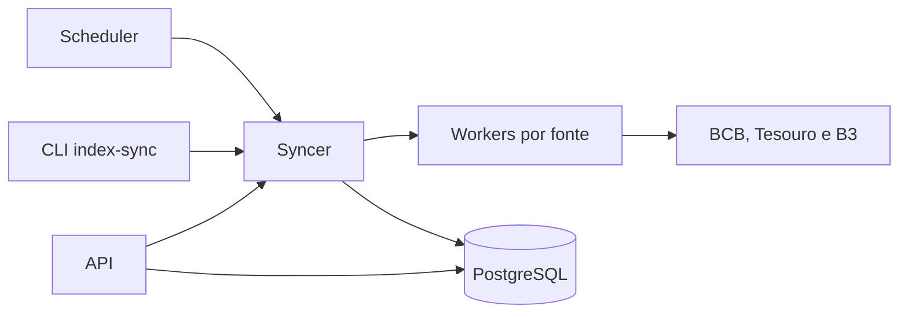

# Introdução

O **Tucano Indices** é um backend Go independente para índices financeiros brasileiros e as séries econômicas usadas como referência de mercado. Ele mantém um catálogo de séries, armazena observações versionadas no PostgreSQL e expõe leitura e operação por HTTP.

O serviço não possui contas de usuário nem papéis. Um token estático protege as rotas da API.

## Componentes

| Componente | Papel |
| --- | --- |
| API (`cmd/api`) | Catálogo, valores finais, séries para gráficos, importação idempotente e operações. |
| Syncer / CLI (`cmd/index-sync`) | Execução pontual de uma fonte ou de todas, com janela de datas. |
| Scheduler (`cmd/scheduler`) | Agenda diária dos workers em dias úteis. |
| Workers | Adaptadores para SGS, Focus, Tesouro, B3 e NovoSelic. |
| PostgreSQL | Catálogo, observações revisionadas, ledger e registros de idempotência. |

## Fluxo de dados



## Execução rápida

```sh
docker compose up --build -d api
make sync-indices SOURCE=all
make indices-scheduler
```

A API responde em `http://localhost:8011`. As rotas `/healthz`, `/swagger` e `/openapi.yaml` são públicas; as demais exigem o token configurado em `API_TOKEN`.

## Como navegar

1. [API](/api) — contrato HTTP, autenticação, formatos e erros.
2. [Sincronização](/operacao/index-sync) — CLI, janelas, locks e ledger.
3. [Scheduler](/operacao/scheduler) — agenda e recuperação de falhas.
4. [Persistência](/operacao/persistence) — modelo de dados e revisões.
5. [Workers](/workers/) — detalhes de cada fonte.
