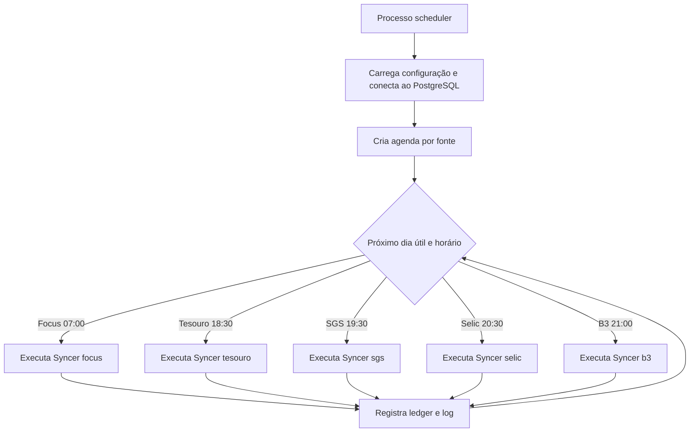

# Scheduler de índices

## Responsabilidade

O processo `cmd/scheduler` mantém um goroutine por fonte e chama o mesmo `Syncer` usado pelo CLI e pela API. A agenda é executada em dias úteis no fuso `America/Sao_Paulo`. Sinais `SIGINT` e `SIGTERM` encerram os timers e cancelam o contexto de execução.

## Agenda

| Fonte | Horário local | Razão operacional |
|---|---:|---|
| Focus | 07:00 | Atualiza expectativas divulgadas no início do dia. |
| Tesouro | 18:30 | Executa após a atualização diária usual das taxas. |
| SGS | 19:30 | Atualiza séries macroeconômicas e financeiras oficiais. |
| Selic apurada | 20:30 | Busca dados detalhados publicados no período noturno. |
| B3 | 21:00 | Atualiza fechamentos dos índices depois do pregão. |

Os horários estão codificados em `cmd/scheduler/main.go`. A regra exclui sábados e domingos; não consulta calendário de feriados de mercado. Cada execução tem timeout de 30 minutos. Logs estruturados indicam fonte, status, pontos lidos e gravados.

## Inicialização

O container `index-scheduler` exige `DATABASE_URL`, banco saudável e migração concluída. Compose habilita o serviço no perfil `indices-scheduler`; o comando recomendado é:

```sh
make indices-scheduler
```

A agenda não expõe HTTP próprio. Acompanhamento e execução manual ficam na API:

- `GET /v1/system/workers` — workers e últimas 20 execuções;
- `GET /v1/operations/sync-runs` — filtra execuções por fonte;
- `POST /v1/indices/sync/{source}` — executa uma fonte imediatamente;
- `POST /v1/operations/sync/{source}` e `POST /v1/system/workers/{source}/run` — aliases de execução.

As rotas da API requerem Bearer token. Execuções automáticas e manuais compartilham os advisory locks por fonte, evitando sobreposição do mesmo worker.

## Falhas e recuperação

Falhas ficam registradas no ledger e aparecem em logs com o identificador da fonte. O próximo disparo agendado tenta executar novamente. Um erro em uma fonte não interrompe os goroutines das outras fontes. O scheduler usa timeout e encerramento por contexto, mas não executa uma segunda tentativa imediata no mesmo horário.

## Fluxo


