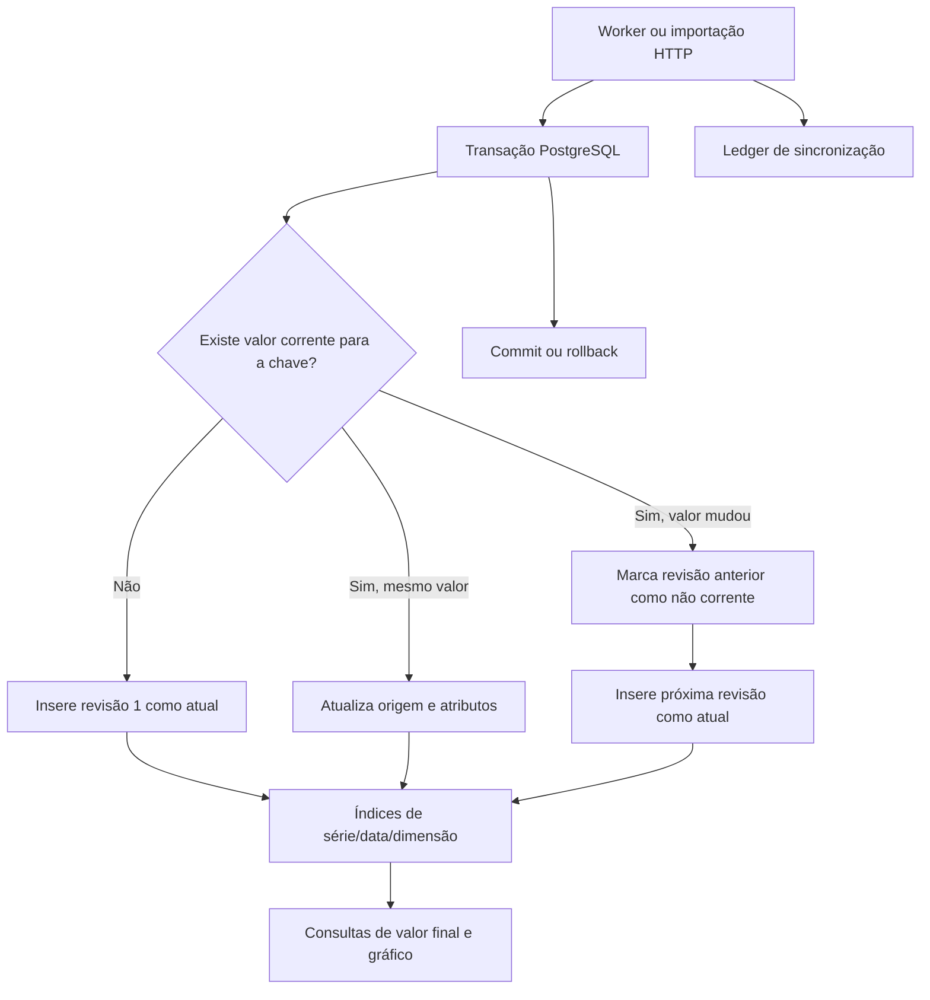

# Persistência e histórico de revisões

## Modelo

A migração `db/migrations/00001_indices.sql` cria quatro tabelas:

- `index_series`: metadados do catálogo, grupo, unidade, frequência, origem e dimensão;
- `index_observations`: valor por código, dimensão e data de referência;
- `index_sync_runs`: ledger de sincronizações por fonte;
- `index_idempotency_records`: chave, hash do corpo e resposta salva de chamadas idempotentes.

O valor fica em `NUMERIC(28,12)` e a API o serializa como string. `attributes` contém dados auxiliares JSONB. Datas são indexadas por série e dimensão para consultas do valor final e séries de gráficos.

## Chave e revisões

A chave lógica de um ponto é `(series_code, dimension, ref_date)`. A tabela mantém todas as revisões em `(series_code, dimension, ref_date, revision)` e uma restrição parcial garante somente uma observação `is_current=true` por chave lógica.

Na ingestão, um valor numericamente igual ao atual não gera revisão; atualiza `source` e `attributes`. Uma correção diferente desmarca a revisão vigente e insere a próxima revisão. O endpoint legado pode expor todas as revisões através de `include_revisions=true`.

## Idempotência

`PUT /v1/indices/{code}/observations` e `POST /v1/selic/import` exigem `Idempotency-Key`. O hash SHA-256 do corpo é associado à operação. Se o par chave/operação/hash já existir, a resposta original é reproduzida. Reutilizar a chave com outro conteúdo/operação gera conflito `409`.

As gravações das observações usam transação e a tabela possui índices únicos para impedir duplicidade de revisão ou mais de um ponto corrente. As execuções de workers usam advisory locks independentes por origem.

## Ledger

Cada `index_sync_runs` registra fonte, status, início/fim, intervalo, quantidade recebida e gravada, além da mensagem de erro. A API lê o ledger em `GET /v1/operations/sync-runs` e aliases `/v1/system/workers` e `/v1/system/workers/runs`.

## Migração e execução

O Compose inicia PostgreSQL e executa Goose antes da API, do sync pontual e do scheduler. Para aplicar migração manualmente, use `make migrate-up`. A migração semeia o catálogo; workers preenchem as observações.

## Fluxo

