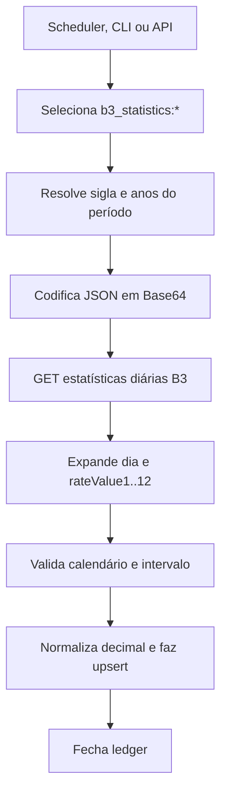

# Worker de índices da B3

## Funcionalidade

O worker sincroniza as séries de índices de ações, fundos imobiliários, dividendos e setores cujo catálogo tenha origem `b3_statistics:<sigla>`. A fonte é o feed público oficial de evolução diária de índices da B3. Os valores de fechamento são preservados como strings decimais.

### Índices cadastrados

| Código Tucano | Identificador B3 | Índice |
|---|---|---|
| `ibov` | `IBOVESPA` | Ibovespa |
| `ibrx100` | `IBXX` | IBrX 100 |
| `ibrx50` | `IBXL` | IBrX 50 |
| `ibra` | `IBRA` | IBrA |
| `smll` | `SMLL` | Small Cap |
| `mlcx` | `MLCX` | MidLarge Cap |
| `idiv` | `IDIV` | Dividendos |
| `ifix` | `IFIX` | Fundos imobiliários |
| `ifnc` | `IFNC` | Setor financeiro |
| `icon` | `ICON` | Consumo |
| `imat` | `IMAT` | Materiais básicos |
| `imob` | `IMOB` | Imobiliário |
| `util` | `UTIL` | Utilidades públicas |
| `ieex` | `IEEX` | Energia elétrica |
| `indx` | `INDX` | Industrial |
| `igcx` | `IGCX` | Governança diferenciada |
| `igct` | `IGCT` | Governança trade |

`curva_di` permanece no catálogo por compatibilidade, mas não pertence ao feed de índices dessa fonte.

## Endpoint upstream e transformação

Base configurável por `INDICES_B3_BASE_URL` (padrão `https://sistemaswebb3-listados.b3.com.br/indexStatisticsProxy/IndexCall`). Para cada ano da janela, o worker faz:

```text
GET {base}/GetPortfolioDay/{base64(JSON)}
```

O JSON codificado contém `index`, `language: "pt-br"` e `year`. A resposta `results[]` informa o dia do mês e os campos `rateValue1` até `rateValue12`. Cada campo preenchido vira um ponto na data formada por ano, número do mês e dia. Dias impossíveis (por exemplo, 31 de fevereiro) e pontos fora do intervalo solicitado são descartados.

O primeiro backfill sem histórico inicia em 1998. Execuções incrementais voltam cinco dias antes do último ponto da série; a janela anual permite remontar os valores em blocos por ano.

## Execução

- API: `POST /v1/operations/sync/b3?from=YYYY-MM-DD&to=YYYY-MM-DD`.
- Alias: `POST /v1/system/workers/b3/run`.
- CLI: `make sync-indices SOURCE=b3 ARGS="-from 1998-01-01 -to YYYY-MM-DD"`.
- Scheduler: dias úteis, às 21:00 em `America/Sao_Paulo`.

## Persistência e falhas

Cada série B3 é consultada individualmente a partir de seu identificador no catálogo. Valores nacionais como `123.456,78` são normalizados para `123456.78`. Mapeamento inválido, erro HTTP, resposta JSON inválida ou valor numérico malformado encerra a fonte com falha. Execuções e contagens são visíveis em `/v1/operations/sync-runs?source=b3`.

## Referência da fonte

[B3 — estatísticas diárias de índices](https://sistemaswebb3-listados.b3.com.br/indexStatisticsPage/daily-evolution/IBOVESPA?language=pt-br)

## Fluxo


