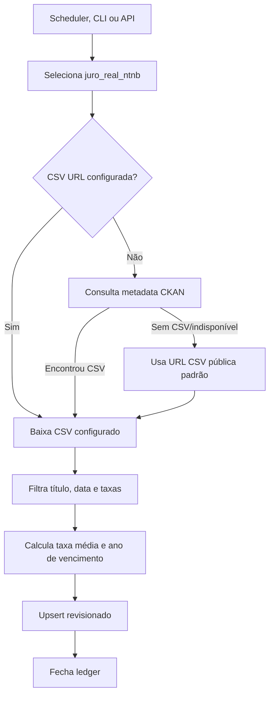

# Worker Tesouro Transparente

## Funcionalidade

O worker atualiza os rendimentos indicativos de títulos Tesouro IPCA+ com juros semestrais (referência NTN-B). Os pontos são agrupados por ano de vencimento na dimensão `maturity_year`. A taxa diária é a média entre compra e venda quando ambas estão disponíveis; caso contrário, utiliza a taxa que existir.

Este é o caminho sem credenciais para a série `juro_real_ntnb`. O feed ANBIMA pago da implementação anterior não é requisito para executar este worker.

## Descoberta do CSV e endpoint upstream

Se `INDICES_TESOURO_CSV_URL` estiver definido, o worker lê o CSV diretamente. Caso contrário:

1. Consulta `INDICES_TESOURO_CKAN_URL` (padrão CKAN `package_show` do dataset de taxas do Tesouro Direto).
2. Escolhe o primeiro recurso cujo formato seja CSV e usa o `url` informado.
3. Se a metadata estiver indisponível ou não trouxer CSV, utiliza o endereço público CSV padrão do projeto.

O CSV usa `;` e deve conter `Tipo Título`, `Data Vencimento`, `Data Base` e pelo menos uma das colunas `Taxa Compra Manhã` ou `Taxa Venda Manhã`. O worker seleciona `Tesouro IPCA+ com Juros Semestrais`, filtra `Data Base` pelo período solicitado e usa o ano da data de vencimento como dimensão. Cabeçalhos portugueses são normalizados sem acentos.

## Execução

- API: `POST /v1/operations/sync/tesouro?from=YYYY-MM-DD&to=YYYY-MM-DD`.
- Alias: `POST /v1/system/workers/tesouro/run`.
- CLI: `make sync-indices SOURCE=tesouro ARGS="-from YYYY-MM-DD -to YYYY-MM-DD"`.
- Scheduler: dias úteis, às 18:30 em `America/Sao_Paulo`.

A carga incremental reconsulta cinco dias a partir do ponto mais recente. Sem histórico, começa em `InitialYear` (2000 no padrão do projeto). A origem salva é `tesouro_transparente`.

## Persistência e falhas

Uma linha que não pertence ao título-alvo, está fora do período, não tem vencimento legível ou não tem taxa utilizável é ignorada. CSV vazio, sem colunas necessárias, falha HTTP ou erro de leitura encerra o worker com `failed`; os detalhes são registrados no ledger. Correções de taxa criam revisões no banco.

## Referência da fonte

[Tesouro Transparente — taxas dos títulos ofertados](https://www.tesourotransparente.gov.br/ckan/dataset/taxas-dos-titulos-ofertados-pelo-tesouro-direto)

## Fluxo

