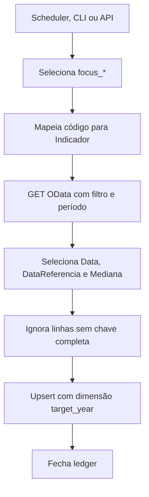

# Worker Focus do Banco Central

## Funcionalidade

O worker sincroniza medianas das expectativas do Relatório Focus para IPCA, Selic e câmbio. Como o Focus mantém projeções para diferentes anos-alvo, `DataReferencia` é persistida como dimensão; a observação também registra a data da publicação do boletim.

### Séries mapeadas

| Código Tucano | Indicador Focus | Unidade | Dimensão |
|---|---|---|---|
| `focus_ipca` | `IPCA` | Percentual anual | `target_year` |
| `focus_selic` | `Selic` | Percentual anual | `target_year` |
| `focus_usd` | `Câmbio` | BRL por USD | `target_year` |

O worker usa a mediana (`Mediana`) e filtra `baseCalculo eq 0` (série anual). Linhas sem data de publicação ou ano-alvo são ignoradas.

## Endpoint upstream

O endpoint base é `INDICES_FOCUS_BASE_URL`, por padrão o serviço OData de Expectativas do BCB. A rota usada é:

```text
{base}/ExpectativasMercadoAnuais
```

Parâmetros OData enviados:

- `$filter`: indicador, `baseCalculo eq 0` e janela `Data ge ... and Data le ...`;
- `$select`: `Indicador,Data,DataReferencia,Mediana,baseCalculo`;
- `$orderby=Data asc`, `$format=json` e `$top=100000`.

O worker consome `value[]` e converte cada item em uma observação com `date=Data`, `dimension=DataReferencia`, `value=Mediana` e origem `bcb_focus`.

## Execução

- API: `POST /v1/indices/sync/focus?from=YYYY-MM-DD&to=YYYY-MM-DD`.
- Aliases: `POST /v1/operations/sync/{source}` e `POST /v1/system/workers/focus/run`.
- CLI: `make sync-indices SOURCE=focus ARGS="-from YYYY-MM-DD -to YYYY-MM-DD"`.
- Scheduler: dias úteis, às 07:00 em `America/Sao_Paulo`.

O incremento reconsulta cinco dias a partir do ponto mais recente de cada série. Sem histórico, usa o ano inicial padrão 2000. O BCB pode revisar expectativas passadas; por isso a sobreposição permite corrigir datas já armazenadas.

## Persistência e falhas

Os valores são guardados por série, ano-alvo e data do boletim. Se uma expectativa mudar para a mesma chave, a observação anterior continua no histórico de revisões. Erros HTTP, JSON inesperado ou data malformada falham a fonte e registram mensagem no ledger.

## Referência da fonte

[Banco Central — expectativas do mercado](https://dadosabertos.bcb.gov.br/dataset/expectativas-mercado)

## Fluxo


