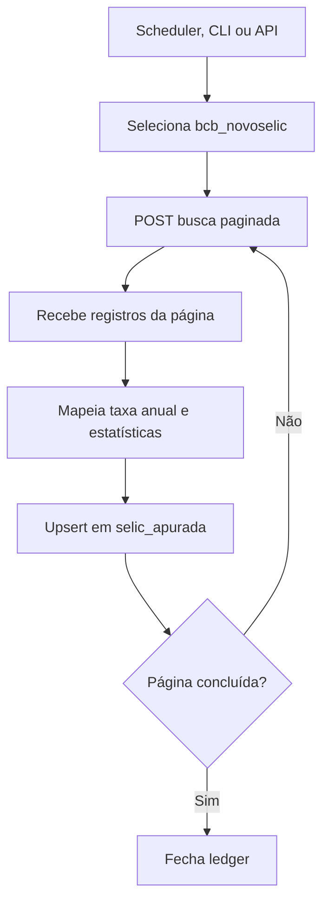

# Worker NovoSelic — Selic apurada

## Funcionalidade

O worker carrega a taxa Selic apurada por dia e as estatísticas do mercado de operações compromissadas publicadas pelo Banco Central. A série persistida é `selic_apurada`, com taxa anual no valor principal e estatísticas adicionais no JSON `attributes`.

Campos reconhecidos na resposta: taxa anual, fator diário, volume financeiro, quantidade de operações, taxa média, mediana, moda, desvio padrão e índice de curtose.

## Endpoint upstream

Endpoint configurável por `INDICES_SELIC_SEARCH_URL`; padrão:

```text
POST https://www3.bcb.gov.br/novoselic/rest/taxaSelicApurada/pub/search?page={n}&pageSize=100
Content-Type: application/json
```

Corpo:

```json
{"dataInicial":"DD/MM/YYYY","dataFinal":"DD/MM/YYYY"}
```

A paginação começa em 1, com 100 linhas por página, e continua até que a resposta venha vazia, tenha menos de 100 registros ou a contagem acumulada alcance `totalItems`. Cada data `dataCotacao` vira `YYYY-MM-DD`; `taxaAnual` é o valor principal.

## Execução

- API: `POST /v1/indices/sync/selic?from=YYYY-MM-DD&to=YYYY-MM-DD`.
- Aliases: `POST /v1/operations/sync/{source}` e `POST /v1/system/workers/selic/run`.
- CLI: `make sync-indices SOURCE=selic ARGS="-from YYYY-MM-DD -to YYYY-MM-DD"`.
- Scheduler: dias úteis, às 20:30 em `America/Sao_Paulo`.

O worker sincroniza somente `selic_apurada`; a meta e a Selic overnight continuam a cargo do worker SGS. Para consultas específicas, a API também expõe `GET /v1/selic`, `GET /v1/selic/latest` e `GET /v1/selic/{date}`. Importação CSV manual é descrita na [referência da API](../api.md).

## Persistência e falhas

A taxa anual é formatada com dez casas decimais e as demais estatísticas são anexadas como atributos, incluindo contagem inteira de operações. Erros HTTP, erro retornado pelo NovoSelic, JSON inválido ou data de cotação inválida falham a execução. A janela é armazenada no ledger e uma reexecução atualiza a mesma chave, criando nova revisão somente em caso de mudança no valor.

## Referência da fonte

[Banco Central — serviço público NovoSelic](https://www3.bcb.gov.br/novoselic/rest/taxaSelicApurada/pub/search)

## Fluxo


