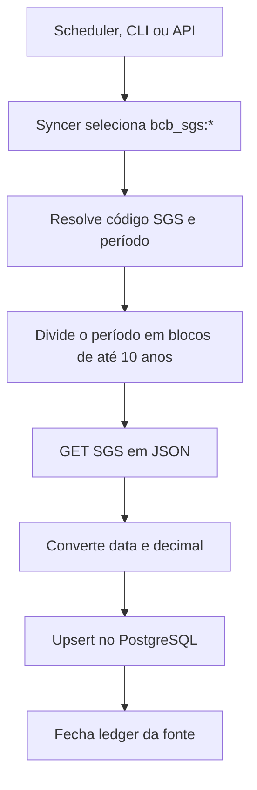

# Worker SGS do Banco Central

## Funcionalidade

O worker coleta séries temporais públicas do Sistema Gerenciador de Séries Temporais (SGS) do Banco Central. É a origem dos indicadores de juros, inflação, câmbio e atividade já publicados em SGS no catálogo.

### Séries mapeadas

| Código Tucano | Código SGS | Conteúdo |
|---|---:|---|
| `selic_meta` | 432 | Meta Selic. |
| `selic_over` | 1178 | Selic efetiva overnight. |
| `cdi` | 12 | CDI anualizado. |
| `tjlp` | 256 | TJLP. |
| `ipca` | 433 | IPCA mensal. |
| `ipca_15` | 7478 | IPCA-15. |
| `ipca_12m` | 13522 | IPCA acumulado em 12 meses. |
| `igpm` | 189 | IGP-M. |
| `inpc` | 188 | INPC. |
| `usdbrl_ptax` | 1 | PTAX venda USD/BRL. |
| `ibc_br` | 24363 | IBC-Br mensal. |

A curva DI (`curva_di`) não é mapeada a SGS. As expectativas do Focus também usam um worker separado.

## Endpoint upstream

O worker faz `GET` no endpoint configurado por `INDICES_SGS_BASE_URL` (padrão `https://api.bcb.gov.br/dados/serie`):

```text
{base}/bcdata.sgs.{codigo}/dados?formato=json&dataInicial=DD/MM/YYYY&dataFinal=DD/MM/YYYY
```

A resposta esperada é um array de objetos `{ "data": "DD/MM/YYYY", "valor": "..." }`. Vírgula decimal é convertida para ponto, e a data é armazenada em ISO. A consulta é dividida em janelas máximas de dez anos para atender o serviço upstream.

## Execução

- API: `POST /v1/indices/sync/sgs?from=YYYY-MM-DD&to=YYYY-MM-DD`.
- Aliases: `POST /v1/operations/sync/{source}` e `POST /v1/system/workers/sgs/run`.
- CLI: `make sync-indices SOURCE=sgs ARGS="-from YYYY-MM-DD -to YYYY-MM-DD"`.
- Scheduler: dias úteis, às 19:30 em `America/Sao_Paulo`.

Em carga incremental, o processo reconsulta desde cinco dias antes da observação mais recente. Sem histórico, começa em 1º de janeiro de 2000 (ou do `InitialYear` configurado no binário).

## Persistência e falhas

Cada série do catálogo com origem `bcb_sgs:<codigo>` é buscada separadamente e gravada como observação da mesma série. Um erro HTTP, JSON inválido, data inválida ou erro de escrita encerra a fonte com falha; a execução e o número de pontos já vistos/gravados ficam no ledger. Reexecuções sobrepostas atualizam metadados de valores idênticos e criam uma nova revisão somente se o número mudar.

## Referência da fonte

[Banco Central — dados abertos e séries SGS](https://dadosabertos.bcb.gov.br/)

## Fluxo


